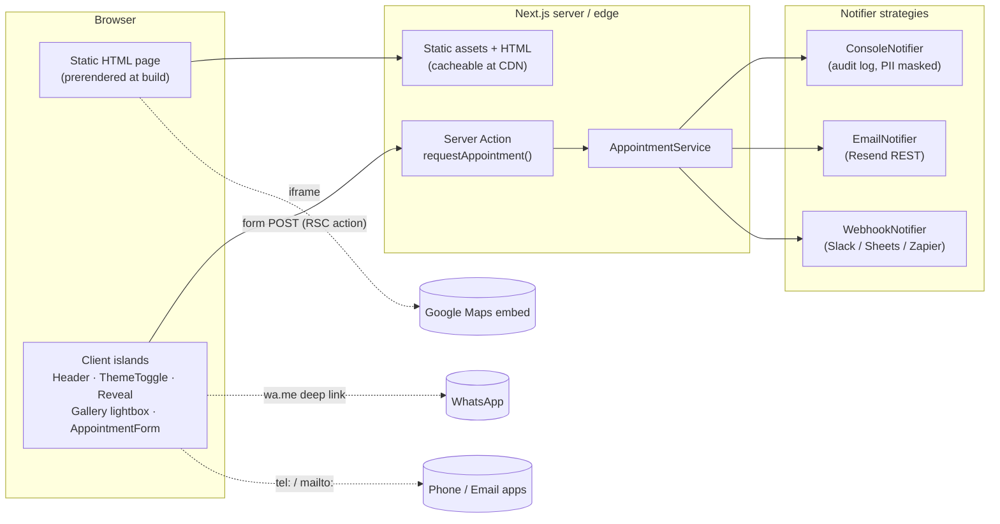
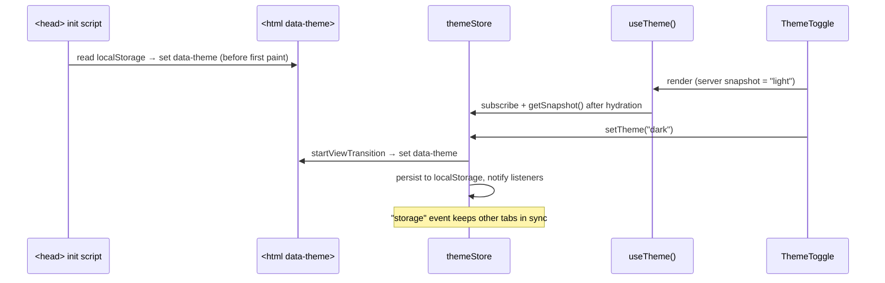
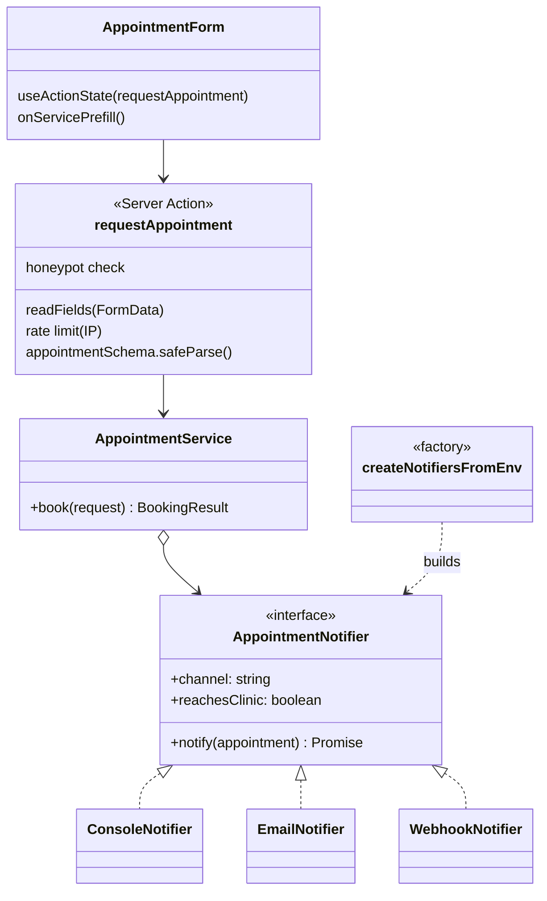
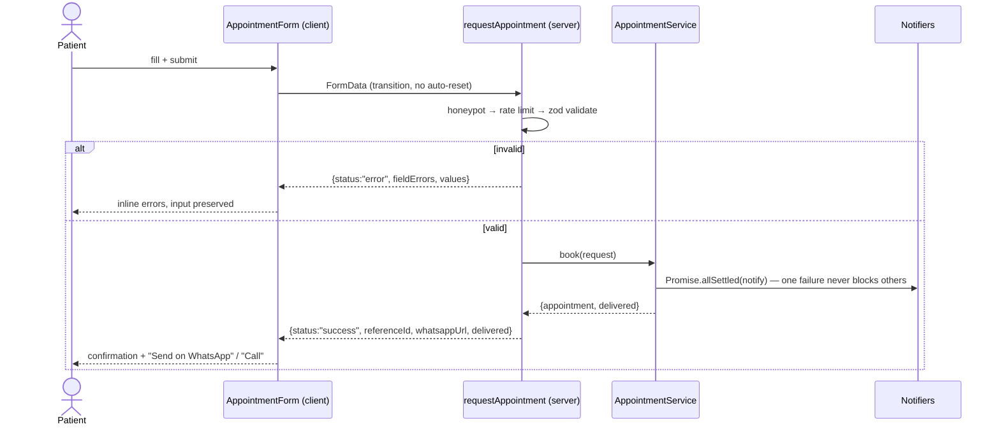

# Moving Cure Website — Architecture & Low-Level Design

Marketing and booking website for **Moving Cure Physiotherapy Clinic & Rehabilitation Centre**
(Dr. Deepak, BPT (D.U.), DCPT — Vishwas Nagar, Delhi).

---

## 1. Goals and constraints

| Goal | How it is met |
| --- | --- |
| Professional, fast, works on any phone | Fully static prerender, optimised images (AVIF/WebP + blur placeholders), mobile-first layout |
| White theme by default, blue dark theme on demand | CSS design tokens + `data-theme` attribute, pre-paint init script (no flash) |
| Patients can book with the least friction | Appointment form → server action, plus one-tap call / WhatsApp everywhere |
| Business details live in one place | `src/config/site.ts` is the single source of truth (transcribed from the visiting card) |
| Easy to grow (CMS, database, more pages) | Layered modules with interfaces at the edges (content modules, notifier strategy, service factory) |

---

## 2. Tech stack

- **Next.js 16** (App Router, Turbopack, Cache Components, Server Actions)
- **React 19** (`useActionState`, `useSyncExternalStore`)
- **TypeScript** (strict) and **Zod 4** for runtime validation
- **Tailwind CSS 4** with semantic design tokens
- **lucide-react** icons, `next/font` (Inter + Plus Jakarta Sans), `next/image`

---

## 3. High-level system design



**Request flow**

1. Every route is prerendered at build time (`○ Static` in the build output) and can be served from a CDN.
2. Only a handful of small client components hydrate (theme, header, reveal animation, gallery, form).
3. A booking is the only dynamic request: the form posts to a Server Action which validates, rate-limits
   and hands the request to the `AppointmentService`, which fans out to every configured notifier.
4. The response always includes a pre-filled WhatsApp link so the patient can confirm instantly even if
   no email/webhook channel is configured.

---

## 4. Layered structure

```
src/
├── app/                      # Routing layer (Next.js conventions only)
│   ├── layout.tsx            #   fonts, metadata, theme init script, page shell
│   ├── page.tsx              #   composes sections + JSON-LD
│   ├── globals.css           #   design tokens (light / dark), base + component styles
│   ├── opengraph-image.tsx   #   social card generated from config
│   ├── sitemap.ts · robots.ts · icon.svg · not-found.tsx
│
├── config/                   # Single source of truth
│   ├── site.ts               #   clinic identity, phones, address, policies, SEO keywords
│   └── navigation.ts         #   nav items ↔ section ids
│
├── content/                  # Content repository (static today, CMS-ready)
│   ├── services.ts · features.ts · faqs.ts · testimonials.ts
│   └── media.ts              #   image registry with alt text + licence credits
│
├── types/                    # Domain types shared by every layer
│
├── features/                 # Vertical slices with their own UI + logic
│   ├── theme/                #   constants · init script · store · hook · toggle
│   └── appointment/          #   schema · constants · types · message · service
│       ├── notifiers/        #   console · email · webhook · factory
│       ├── actions.ts        #   Server Action (controller)
│       ├── prefill.ts        #   decoupled "book this treatment" event channel
│       └── components/       #   AppointmentForm · BookingConfirmation · FormField · BookServiceLink
│
├── components/
│   ├── ui/                   # Design-system primitives (Button styles, Section, Reveal, Logo…)
│   ├── layout/               # TopBar · SiteHeader · SiteFooter · FloatingContact
│   └── sections/             # One file per page section
│
├── hooks/                    # Generic client hooks (scroll spy, scrolled, today)
├── lib/                      # Pure utilities (contact links, dates, rate limit, env, SEO builders)
└── assets/images/            # Statically imported photos (dimensions + blur known at build)
```

**Dependency rule** — imports only point downward:

```
app  →  components/sections  →  features  →  components/ui  →  lib / content / config  →  types
```

`types` imports nothing; `lib` never imports React; `features/appointment/service.ts` imports no
framework code at all, so it is unit-testable with fake notifiers.

---

## 5. Low-level design

### 5.1 Configuration and content

```ts
interface SiteConfig {
  name; legalName; tagline; description; url; locale; timeZone;
  practitioner: { name; qualifications[]; role };
  contact: { phones: PhoneNumber[]; whatsapp; email; address: PostalAddress };
  policies: { homeVisitOnCall; consultationChargeable };
  keywords[];
}
```

- `siteConfig` is declared `as const satisfies SiteConfig` → literal types **and** compile-time shape checks.
- Content modules export typed arrays (`Service[]`, `Faq[]`, `SessionPhoto[]`…). Swapping them for a
  CMS fetch only changes the module body; consumers keep the same types.
- `lib/contact-links.ts` is the only place that builds `tel:`, `mailto:`, `wa.me` and Maps URLs.

### 5.2 Theme subsystem



- **Source of truth is the DOM attribute**, wrapped by an observable store shaped for
  `useSyncExternalStore` — no context provider, no hydration mismatch.
- Default is always the white theme; the OS preference is intentionally ignored (brand requirement).
- Components never branch on theme: they use semantic tokens (`bg-surface`, `text-muted`, `text-brand`).

### 5.3 Appointment subsystem





Key decisions:

- **Validation** lives in one Zod schema (`schema.ts`): Indian mobile normalisation to E.164, date window
  (today → +90 days, computed in `Asia/Kolkata`), enum-checked treatment/visit type, length limits.
- **`delivered` flag** is true only if a staff-facing channel succeeded; the UI copy changes accordingly,
  so patients are never told “the clinic has your request” when it doesn’t.
- **View-model union** (`AppointmentFormState`) keeps the action’s response serialisable and the UI
  exhaustive (`idle | error | success`).
- **Progressive enhancement**: the `<form action>` still works without JavaScript; with JS the submit is
  dispatched in a transition to avoid React’s automatic field reset on errors.
- **Prefill channel** (`prefill.ts`): service cards dispatch a `CustomEvent`; the form subscribes. Neither
  knows about the other.

### 5.4 UI composition

- `page.tsx` is an ordered list of sections → add/remove/reorder in one line.
- Sections are **Server Components**; interactivity is isolated in small client islands.
- `Section` + `SectionHeading` enforce consistent rhythm, landmarks (`aria-labelledby`) and anchors.
- `buttonClasses()` is a pure style function, so `<a>`, `<button>` and `<Link>` share one look.
- `Reveal` uses a **single shared IntersectionObserver** (flyweight); hidden state only applies once JS
  confirms it can reveal (`html[data-js]`), so content is always visible to crawlers and no-JS users.

---

## 6. Design patterns used

| Pattern | Where |
| --- | --- |
| Single source of truth | `config/site.ts` drives header, footer, contact, links, SEO, OG image |
| Strategy | `AppointmentNotifier` implementations (console / email / webhook) |
| Factory | `createNotifiersFromEnv()` builds the notifier chain from configuration |
| Dependency injection + composition root | `createAppointmentService(deps)` / `getAppointmentService()` |
| Observer | `themeStore` (+ cross-tab `storage` events), prefill `CustomEvent` channel |
| Flyweight | One `IntersectionObserver` shared by all `Reveal` elements |
| Adapter / builder | `lib/contact-links.ts`, `lib/seo/structured-data.ts` |
| View-model | `AppointmentFormState` discriminated union |

---

## 7. Cross-cutting concerns

**Security**
- Server-side Zod validation (client checks are UX only); honeypot field; per-IP rate limit (5 / 10 min).
- Env validated at first use (`lib/env.ts`), secrets server-only (`import "server-only"`).
- PII masked in logs; JSON-LD escaped against `</script>` injection; security headers in `next.config.ts`.

**Performance**
- Static prerender of every route; images statically imported (intrinsic size + blur), AVIF/WebP,
  responsive `sizes`, hero `preload`; fonts self-hosted via `next/font`; map iframe lazy-loaded.

**Accessibility**
- Skip link, landmarks, labelled sections, `aria-current` in nav, focus-visible rings, native
  `<details>` FAQ and `<dialog>` lightbox (focus trap + Esc), errors wired with `aria-describedby`,
  `prefers-reduced-motion` respected.

**SEO**
- Metadata API (title template, canonical, Open Graph, Twitter), generated OG image, sitemap, robots,
  `Physiotherapy` (MedicalBusiness) + `FAQPage` structured data.

---

## 8. Extension points & scaling

| Need | Change |
| --- | --- |
| Store bookings | Add an `AppointmentRepository` (Postgres/Supabase/Sheets) and call it in `AppointmentService.book()` before notifying |
| Multiple server instances | Replace the in-memory map in `lib/rate-limit.ts` with Redis/Upstash behind the same `check()` |
| Content editing by staff | Replace `content/*.ts` bodies with CMS queries wrapped in `"use cache"` |
| New pages (e.g. per-condition pages) | Add `app/treatments/[slug]/page.tsx` using `services` + `generateStaticParams` |
| SMS / WhatsApp Business API alerts | New `AppointmentNotifier` implementation + one line in the factory |

---

## 9. Before going live

- [ ] Replace the sample testimonials in `src/content/testimonials.ts` with real, consented patient reviews.
- [ ] Replace stock photos in `src/assets/images/` with real clinic photos (with patient consent).
- [ ] Confirm `+91 99100 84082` is the right WhatsApp number (`siteConfig.contact.whatsapp`).
- [ ] Set `NEXT_PUBLIC_SITE_URL` and at least one delivery channel (`RESEND_API_KEY` or `APPOINTMENT_WEBHOOK_URL`).
