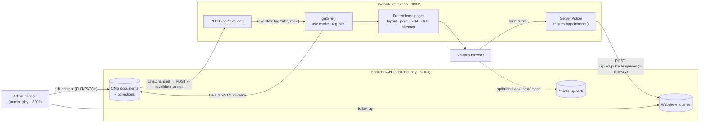
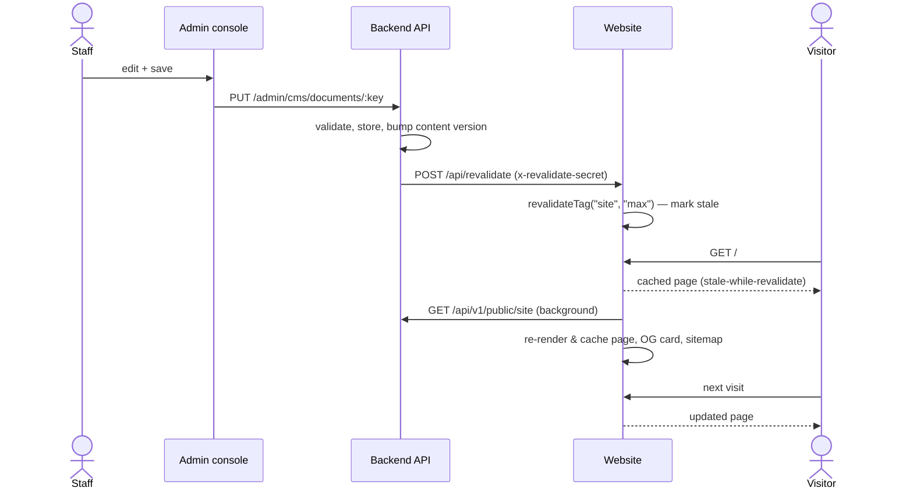
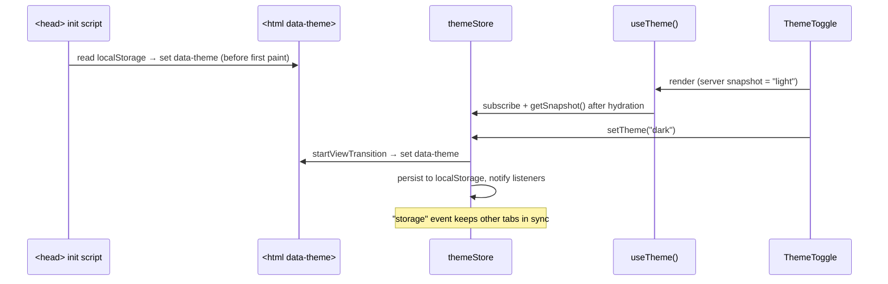
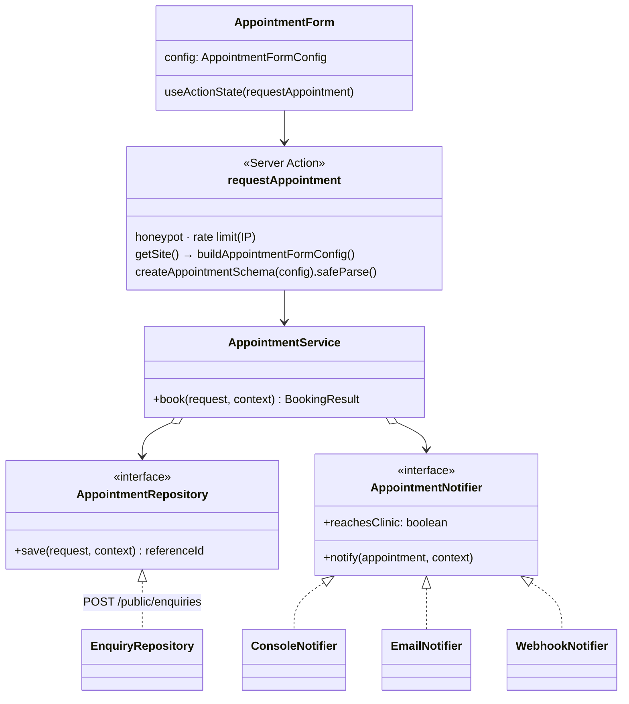
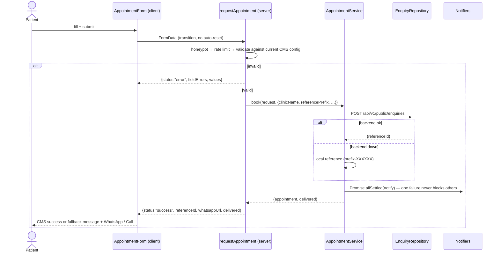

# Clinic Website — Architecture & Low-Level Design

Public marketing and booking website of the physiotherapy clinic platform. The website holds the
design only: all business content is managed in the backend CMS (`backend_phy`) through the admin
console (`admin_phy`), and appointment requests land in the backend's enquiries inbox.

---

## 1. Goals and constraints

| Goal | How it is met |
| --- | --- |
| Staff change any content without a developer | Every text, image, option and toggle comes from the CMS payload; nothing business-specific is in the code |
| Fast, works on any phone | Pages are prerendered from cached CMS data (static shell), optimised images (AVIF/WebP), mobile-first layout |
| Changes go live right away | The backend pings `POST /api/revalidate` after each edit → tag-based revalidation |
| The site never breaks because of the CMS | Lenient payload validation; API outages degrade to the last good content or a brief "be right back" page that heals itself; the build never needs the API |
| Patients can book with the least friction | Appointment form → server action → backend enquiries, plus one-tap call / WhatsApp everywhere |
| White theme by default, blue dark theme on demand | CSS design tokens + `data-theme` attribute, pre-paint init script (no flash) |

---

## 2. Tech stack

- **Next.js 16** (App Router, Turbopack, Cache Components: `use cache`, `cacheTag`, `cacheLife`, Server Actions)
- **React 19** (`useActionState`, `useSyncExternalStore`)
- **TypeScript** (strict) and **Zod 4** for runtime validation
- **Tailwind CSS 4** with semantic design tokens
- **lucide-react** icons, `next/font` (Inter + Plus Jakarta Sans), `next/image`

---

## 3. System context and data flow



#### Content change, end to end



---

## 4. Caching, revalidation and API outages

`src/lib/cms/get-site.ts` is the only reader of the CMS:

```ts
export async function getSite(): Promise<Site | null> {
  "use cache";
  cacheTag("site");
  try   { …fetch + validate…; cacheLife("hours");  return site; }
  catch { cacheLife({ stale: 30, revalidate: 30, expire: 300 }); return lastGoodSite ?? null; }
}
```

| Situation | Behaviour |
| --- | --- |
| Normal | Payload cached with the `hours` profile; every route that reads it (layout, page, metadata, viewport, 404, OG card, sitemap) is prerendered into the static shell. Route revalidate = 1 h, expire = 1 d (see the build output). |
| Content edited | Backend calls `POST /api/revalidate` → `revalidateTag("site", "max")`: the next request is served the cached page while fresh content renders in the background; later requests get the new content. The hourly lifetime is only a safety net for a lost ping. |
| API down at build time | The fetch fails fast (5 s timeout), a warning is logged, and every route is prerendered as a minimal brand-less "We'll be right back" page (`noindex`) with a 30 s revalidate / 5 min expire, so it heals itself within ~30 s of the API coming back — no rebuild. |
| API down later | A failed refresh returns the last content this server fetched (`lastGoodSite`) with the same short lifetime, so visitors keep seeing the site while it retries. |
| Malformed content | `src/lib/cms/schema.ts` strips unknown keys, replaces a bad field with its empty value and drops (and logs) a bad collection item, instead of failing the page. |

The revalidation route compares `x-revalidate-secret` with `REVALIDATE_SECRET` in constant time
(SHA-256 + `timingSafeEqual`): `401` on mismatch, `503` when the secret is not configured.

---

## 5. Layered structure

```text
src/
├── app/                        # Routing layer (Next.js conventions only)
│   ├── layout.tsx              #   fonts, metadata/viewport from CMS, theme init script, chrome or "be right back"
│   ├── page.tsx                #   CMS-ordered sections + JSON-LD
│   ├── not-found.tsx           #   404 copy from CMS
│   ├── opengraph-image.tsx     #   share card generated from CMS data
│   ├── api/revalidate/route.ts #   on-demand revalidation hook for the backend
│   └── sitemap.ts · robots.ts · icon.svg · globals.css
│
├── lib/
│   ├── cms/                    # CMS data layer
│   │   ├── types.ts            #   public payload types (mirror of ADMIN_API.md §12)
│   │   ├── schema.ts           #   lenient zod validation
│   │   ├── get-site.ts         #   cached fetch (`use cache`, tag "site") + outage handling
│   │   ├── selectors.ts        #   visible sections, menu, call/book actions
│   │   ├── media.ts            #   decides whether next/image may optimise a CMS image
│   │   └── origins.ts          #   API/media origins (shared with next.config.ts)
│   ├── seo/                    #   metadata, share image, JSON-LD builders
│   ├── icons.ts                #   CMS icon name → lucide component
│   ├── contact-links.ts · date.ts · env.ts · rate-limit.ts · site-url.ts · cn.ts
│
├── features/
│   ├── theme/                  #   constants · init script · store · hook · toggle
│   └── appointment/
│       ├── config.ts           #   form config derived from the CMS (shared client/server)
│       ├── schema.ts           #   zod schema factory built from that config
│       ├── actions.ts          #   Server Action (controller)
│       ├── service.ts          #   orchestration (repository + notifiers)
│       ├── enquiry-repository.ts #  primary channel: backend enquiries
│       ├── notifiers/          #   console · email · webhook · factory
│       ├── message.ts · prefill.ts · types.ts
│       └── components/         #   AppointmentForm · BookingConfirmation · FormField · BookServiceLink
│
├── components/
│   ├── ui/                     # Primitives: Section, SectionHeading, Reveal, Logo, ContentImage, CmsIcon, InlineMarkup…
│   ├── layout/                 # TopBar · SiteHeader · SiteFooter · FloatingContact · SiteUnavailable
│   └── sections/               # One file per page section, each takes the CMS `site`
│
└── hooks/                      # Generic client hooks (scroll spy, scrolled, today)

public/images/                  # Seed photos referenced by the CMS as /images/<name>.jpg
```

**Dependency rule** — imports only point downward:

```text
app  →  components/sections  →  features  →  components/ui  →  lib (cms, seo, …)
```

`lib/cms/types.ts` imports nothing; `features/appointment/service.ts` imports no framework code,
so it is unit-testable with a fake repository and notifiers.

---

## 6. Low-level design

### 6.1 Rendering from the CMS

- Server Components receive CMS data as props (`site`, or the specific document/collection).
  Client islands (`SiteHeader`, `SessionGallery`, `AppointmentForm`) get plain serialisable props;
  the logo is rendered on the server and passed to the header as a node.
- `page.tsx` maps `site.layout.sections` (in order) to section components through a registry.
  `visibleSections()` drops disabled sections and sections without content; `visibleNavigation()`
  drops menu links whose target is not on the page.
- Empty optional strings hide their element; a missing optional image removes its column without
  breaking the grid.
- `**bold**` in the hero intro is rendered by `InlineMarkup` into `<strong>` nodes — no HTML parsing,
  no `dangerouslySetInnerHTML`.
- Icons are allow-listed kebab-case Lucide names (`lib/icons.ts`), with a fallback icon.
- Images use `next/image` with a string `src`: `/images/*` from `public/`, or uploads from the API.
  `images.remotePatterns` is built from `API_URL` (`/media/**`) and `MEDIA_ORIGINS`;
  `ContentImage`/`imageSource()` render any other host (or a private-network host the optimiser
  refuses) unoptimised instead of failing. Containers show a neutral background while loading.
- Metadata (`generateMetadata`), viewport (`themeColor`), `<html lang>`, JSON-LD (clinic + FAQ),
  the OG card, sitemap `lastModified` (content version) all derive from the same cached payload.
  The site origin (`NEXT_PUBLIC_SITE_URL`) is deployment config.

### 6.2 Theme subsystem



- **Source of truth is the DOM attribute**, wrapped by an observable store shaped for
  `useSyncExternalStore` — no context provider, no hydration mismatch.
- Components never branch on theme: they use semantic tokens (`bg-surface`, `text-muted`, `text-brand`).

### 6.3 Appointment subsystem





Key decisions:

- **Options and limits come from the CMS** (treatments + optional "not sure" option, visit types,
  time slots, booking window, message length, time zone). The same `AppointmentFormConfig` feeds
  the form and the zod schema factory, and the action rebuilds it from the current CMS payload, so
  a stale page can never submit an option that no longer exists.
- **Labels, not ids, reach the backend** — the enquiries inbox is read by people. Phone numbers are
  normalised to E.164; the reference prefix is the CMS monogram reduced to `[A-Z0-9]{1,6}`.
- **`delivered`** is true when the backend stored the request or a staff-facing notifier succeeded;
  otherwise the patient sees the CMS fallback message and is asked to confirm on WhatsApp / by phone.
- **Progressive enhancement**: the `<form action>` works without JavaScript.

---

## 7. Design patterns used

| Pattern | Where |
| --- | --- |
| Single source of truth | The CMS payload drives every section, chrome, metadata, OG card and the form |
| Repository + Strategy | `AppointmentRepository` (backend enquiries) and `AppointmentNotifier` implementations |
| Factory | `createNotifiersFromEnv()`, `createAppointmentSchema(config)` |
| Dependency injection + composition root | `createAppointmentService(deps)` / `getAppointmentService()` |
| Registry | `page.tsx` section id → component map; `lib/icons.ts` name → icon |
| Observer | `themeStore` (+ cross-tab `storage` events), prefill `CustomEvent` channel |
| Flyweight | One `IntersectionObserver` shared by all `Reveal` elements |
| Adapter / builder | `lib/contact-links.ts`, `lib/seo/*` |
| View-model | `AppointmentFormState` discriminated union |

---

## 8. Cross-cutting concerns

#### Security

- Server-side Zod validation (client checks are UX only); honeypot; per-IP rate limit (5 / 10 min).
- `API_URL`, `WEBSITE_API_KEY`, `REVALIDATE_SECRET` are server-only (`import "server-only"` modules).
- CMS text is rendered as React text (escaped); links from the CMS are restricted to http(s); JSON-LD
  is escaped against `</script>` injection; security headers in `next.config.ts`.
- The image optimiser only fetches from the configured media origins and never from private hosts.

#### Performance

- Static prerender of every page from cached CMS data; AVIF/WebP, responsive `sizes`, hero
  `preload`; fonts self-hosted via `next/font`; map iframe lazy-loaded.

#### Accessibility

- Skip link, landmarks, labelled sections, `aria-current` in nav, focus-visible rings, native
  `<details>` FAQ and `<dialog>` lightbox, errors wired with `aria-describedby`,
  `prefers-reduced-motion` respected.

#### SEO

- Metadata API (title template, canonical, Open Graph, Twitter) from the CMS; share image from the
  CMS or the generated card (URL carries the content version to refresh social caches); sitemap with
  the content version as `lastmod`; `Physiotherapy` (MedicalBusiness) + `FAQPage` structured data.

---

## 9. Extension points

| Need | Change |
| --- | --- |
| New editable field or section | Add it to the backend CMS registry, mirror it in `lib/cms/types.ts` + `schema.ts`, render it; register new sections in `page.tsx` |
| Multiple server instances | Use a shared cache handler (`use cache: remote`) and replace the in-memory rate limiter with Redis/Upstash |
| More pages (e.g. per-treatment pages) | `app/treatments/[slug]/page.tsx` reading `getSite()` + `generateStaticParams` |
| SMS / WhatsApp Business alerts | New `AppointmentNotifier` + one line in the factory |

---

## 10. Before going live

- [ ] Set `NEXT_PUBLIC_SITE_URL`, `API_URL`, `WEBSITE_API_KEY` and `REVALIDATE_SECRET` (and the
      backend's `WEBSITE_REVALIDATE_URL` / `WEBSITE_REVALIDATE_SECRET` / `WEBSITE_API_KEY`).
- [ ] Add the backend's public media origin to `MEDIA_ORIGINS` if it differs from `API_URL`.
- [ ] Publish only real, consented testimonials; replace stock photos with real clinic photos.
- [ ] Confirm the WhatsApp number and contact details in the CMS.
